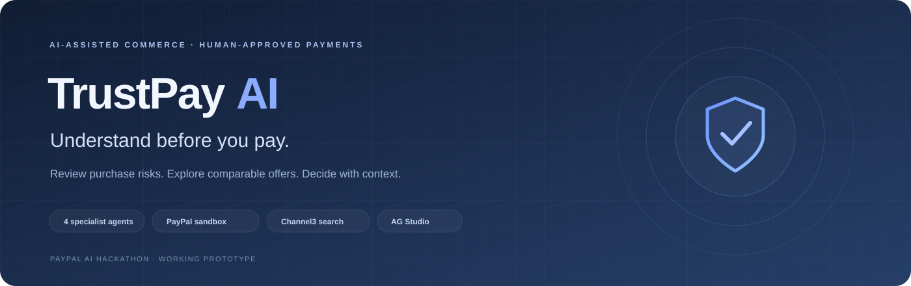
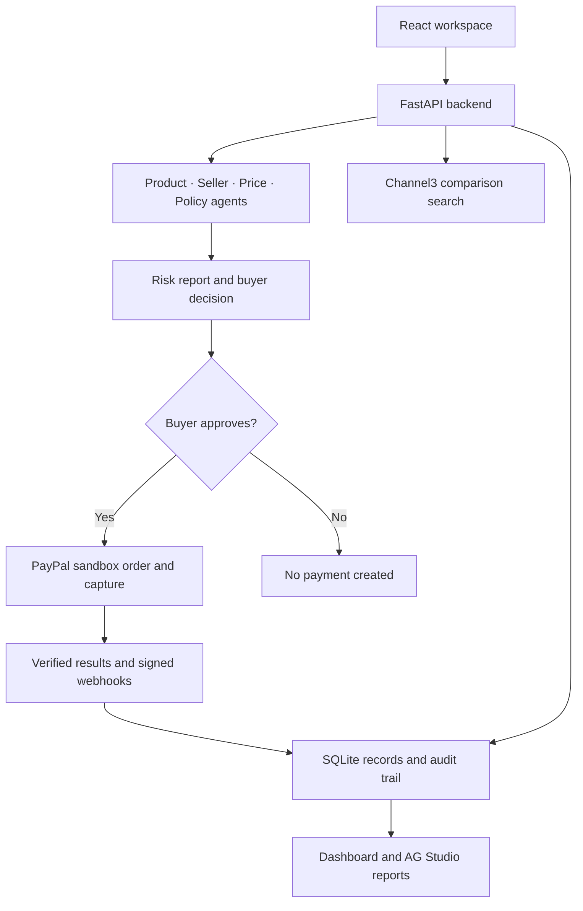

<div align="center">



<br />

**An AI-assisted purchase review platform with human approval and PayPal sandbox checkout.**


[Overview](#overview) · [Features](#features) · [Architecture](#architecture) · [Run locally](#run-locally) · [Testing](#testing) · [Documentation](#documentation)

</div>

---

## Overview

A product listing rarely tells the whole story. An unusually low price, unclear returns or a request to pay outside a marketplace can leave a buyer with unanswered questions before checkout.

**TrustPay AI brings those signals into one review.** Four specialist agents examine product information, seller claims, pricing and policies. The application explains its findings, lets the buyer compare other offers through Channel3, and requires a recorded human decision before creating a PayPal order.

Built for the **PayPal AI Hackathon**, this prototype combines an actual payment API integration with AI-assisted reasoning, a working dashboard and a traceable purchase-to-payment flow.

> **Sandbox prototype:** Checkout uses test funds and pays the configured sandbox merchant. External retailer links are comparison links; TrustPay does not purchase from those retailers on the buyer's behalf. Risk scores are heuristic indicators, not fraud probabilities or guarantees of a safe transaction.

## Features

| Capability | What it does |
| --- | --- |
| **Four specialist agents** | Review product, seller, price and policy signals using deterministic rules plus an LLM. |
| **Explainable findings** | Show individual agent reports, risk indicators, missing information and questions to ask the seller. |
| **Human approval gate** | Block order creation until the buyer approves. Higher-risk cases require acknowledgement; critical cases also require a written reason. |
| **Channel3 comparisons** | Search product offers with explicit prices, currencies, retailer links and retrieval timestamps. |
| **PayPal checkout** | Create sandbox orders, capture payments and verify returned payment details against the assessment. |
| **Payment lifecycle** | Track order status, refunds and audit events; accept signature-verified PayPal webhooks when configured. |
| **Analytics workspace** | Explore activity, risk distribution, payment history, searchable reports and average-risk charts. |
| **AG Studio editor** | Switch from the designed report presentation to the editable AG Studio canvas. |
| **Developer tools** | Inspect non-secret configuration, open API documentation and test PayPal authentication. |
| **Polished interface** | Light/dark themes, responsive layouts, short transitions and operating-system reduced-motion support. |
| **Checkout languages** | Request English, Arabic or French before creating a PayPal order. PayPal may apply account or regional fallbacks. |

### The agents

| Agent | Focus |
| --- | --- |
| **Product** | Thin descriptions, counterfeit wording, urgency and attempts to manipulate AI reviewers. |
| **Seller** | Available reputation/history signals, off-platform contact and requests for unprotected payment. |
| **Price** | Discount plausibility against a supplied reference or a clearly labelled AI estimate. |
| **Policy** | Stated return/refund terms, return windows and delivery information. |
| **Orchestrator** | Combine specialist findings into a buyer-facing recommendation and overall risk indicator. |

When the LLM is unavailable, the interface explicitly marks the result as rules-only. Missing information and seller-supplied claims should not be treated as independently verified facts.

## Architecture



The Channel3 feed provides comparison candidates; it does **not** automatically verify a seller, set a PayPal recipient or change an assessment's risk score. The designed report view and editable AG Studio canvas use the stored assessment data, with independent layouts.

## Technology

| Layer | Tools |
| --- | --- |
| Frontend | React, Vite, CSS, SVG visualizations |
| API | Python, FastAPI, Pydantic, httpx |
| AI | Anthropic or an OpenAI-compatible chat API, configured server-side |
| Payments | PayPal Orders v2, Payments v2 and webhook signature verification |
| Product data | Channel3 search API |
| Reports | AG Studio / AG Grid |
| Storage | SQLite |
| Deployment | Docker and a Render Blueprint |

## Run locally

**Prerequisites:** Python 3.11+, Node.js 22.12+ and npm. Obtain PayPal sandbox credentials, an LLM API key and a Channel3 key for product comparisons.

### 1. Clone the repository

```bash
git clone https://github.com/yasmeenmh90-beep/trustpay-ai.git
cd trustpay-ai
```

### 2. Configure and start the backend

```bash
cd backend
python3 -m venv .venv
.venv/bin/python -m pip install -r requirements.txt
cp -n .env.example .env
```

Edit **`backend/.env`** with your actual credentials. For the OpenAI configuration used by this example:

```dotenv
PAYPAL_CLIENT_ID=your_sandbox_client_id
PAYPAL_CLIENT_SECRET=your_sandbox_client_secret
PAYPAL_BASE_URL=https://api-m.sandbox.paypal.com

LLM_PROVIDER=openai
OPENAI_API_KEY=your_api_key
LLM_MODEL=gpt-4o-mini
OPENAI_BASE_URL=https://api.openai.com/v1

CHANNEL3_API_KEY=your_channel3_key
TRUSTPAY_API_KEY=your_generated_access_key

PUBLIC_BASE_URL=http://localhost:8000
FRONTEND_URL=http://localhost:5173
ALLOWED_ORIGINS=http://localhost:5173
PAYPAL_LOCALE=en-US
PAYPAL_WEBHOOK_ID=
```

Select a model available to your provider account. The supplied `.env.example` also documents the Anthropic configuration. PayPal credentials and an LLM key are required at startup; Channel3 comparisons need their own key.

Generate a TrustPay access key locally:

```bash
.venv/bin/python -c "import secrets; print(secrets.token_urlsafe(32))"
```

Put the output in `TRUSTPAY_API_KEY`, then start the API **from the backend directory**:

```bash
.venv/bin/python -m uvicorn app.main:create_app --factory --reload --port 8000
```

### 3. Start the frontend in a second terminal

From the project root:

```bash
cd frontend
npm ci
cp -n .env.example .env
npm run dev
```

Open **http://localhost:5173**, click **Connect API**, and enter the value of `TRUSTPAY_API_KEY`.

| Local service | Address |
| --- | --- |
| Application | http://localhost:5173 |
| Backend | http://localhost:8000 |
| Interactive API documentation | http://localhost:8000/docs |

The access key is kept in browser memory, so reconnect after reloading or returning from PayPal. Service secrets stay in `backend/.env`; do not put them in frontend `VITE_` variables.

<details>
<summary><strong>Common setup issues</strong></summary>

- **No module named app:** start the API from `backend`, not the repository root.
- **`.venv/bin/python` missing:** create the virtual environment inside `backend` first.
- **AG Studio imports missing:** run `npm ci` inside `frontend`; confirm you copied the matching package files.
- **`process.cwd` / `uv_cwd`:** the Terminal's old directory may have been replaced. Change into the current project folder again.
- **401 from TrustPay:** enter the correct `TRUSTPAY_API_KEY` in Connection settings.
- **Rules-only AI results:** inspect backend warnings and your provider's key, model access and billing/quota. Do not share credential-bearing logs.
- **PayPal language unchanged:** use a fresh assessment/order; a private browser session can help isolate saved account preferences. The application requests a locale but does not control PayPal's hosted page.

</details>

## Demonstration flow

1. **Review:** enter a product listing URL or manual details.
2. **Inspect:** read the risk indicator, agent findings, AI status and missing information.
3. **Compare:** search the exact product model through Channel3; check condition, currency, shipping and taxes.
4. **Decide:** reject the purchase or explicitly approve it. A critical assessment needs acknowledgement and a reason.
5. **Pay:** choose a checkout language and complete PayPal using a **sandbox personal buyer account**.
6. **Verify:** reconnect if prompted, refresh the payment/audit trail and inspect the Payments page.
7. **Explore:** open Overview, Analytics Studio and Developer for reports and integration configuration.

A public HTTPS endpoint and registered webhook ID are needed for real PayPal webhook delivery. A local redirect/capture walkthrough does not, by itself, verify webhook behavior. See [sponsor and deployment setup](SPONSOR_SETUP.md).

## Testing

Backend tests use a stateful fake PayPal transport, mocked Channel3 responses and stubbed LLM calls. They do not require production credentials or move money.

```bash
# From backend
.venv/bin/python -m pytest -q
```

```bash
# From frontend
npm test
npm run build
```

The current source includes **57 backend tests** and **3 frontend aggregation checks**. Coverage includes approval gates, capture verification, order reuse, refunds, webhook processing, ingestion guards, protected diagnostics, checkout locale handling and per-currency analytics.

Browser checks during development exercised themes, navigation, report filtering, risk averages, AG Studio editing, responsive layouts and reduced-motion behavior using test API responses. Live provider calls, hosted checkout language behavior and a deployed webhook must still be verified with your own sandbox setup.

## Deployment

The multi-stage [Dockerfile](Dockerfile) builds the frontend and serves it with the backend from one origin. [render.yaml](render.yaml) defines a Render web service and persistent SQLite disk.

- Set `PUBLIC_BASE_URL` and `FRONTEND_URL` to the deployed HTTPS service URL.
- Supply service credentials through deployment environment settings.
- Register `/api/paypal/webhook` in your PayPal sandbox app.
- Configure an AG Studio trial/commercial license for hosted evaluation.
- The included Blueprint uses a paid service/disk configuration; inspect current plan costs before deploying.

**Render deployment support is included; this repository does not claim an active hosted demo.**

## Limitations and boundaries

- The prototype uses a shared access key, not individual user accounts or per-user authorization. Do not expose private customer records or distribute merchant/admin access to public visitors.
- Seller age, reputation and policy data depend on what was supplied or extracted. The model cannot independently establish authenticity.
- Risk thresholds are hand-tuned. AI-generated market estimates can be inaccurate or out of date.
- Pages requiring JavaScript execution or authentication may need manual entry.
- Analytics cover the latest 100 stored assessments. Activity uses UTC dates; payment totals are separated by currency and exclude refunded/reversed records.
- SQLite and in-memory rate limiting are intended for a single-instance prototype. The URL-fetch guard does not fully prevent DNS rebinding.
- Changing language does not create a duplicate payment: existing orders keep their original locale; an explicit conflicting request is rejected.
- AG Studio is a separately licensed dependency. Its editor layout is independent of the designed report presentation.

## Documentation

| Guide | Contents |
| --- | --- |
| [Sponsor setup](SPONSOR_SETUP.md) | Channel3, AG Studio, PayPal callbacks and Render configuration |
| [Backend reference](BACKEND_REFERENCE.md) | Detailed agent logic, API routes and payment behavior |
| [Local update guide](UPDATE_LOCAL.md) | Apply frontend updates while preserving credentials and data |
| [GitHub publishing](PUBLISHING.md) | Create an empty repository and push the project safely |
| [License](LICENSE) | MIT terms and original copyright notice |

## Maintainer and license

Maintained by **[Yasmeen Azmat](https://github.com/yasmeenmh90-beep)** · [Portfolio](https://yasmeenazmat.com) · [LinkedIn](https://www.linkedin.com/in/yasmeen-azmat-a02b44340)

Project source is distributed under the **MIT License**. Existing copyright notices are retained in [LICENSE](LICENSE). AG Studio and other dependencies remain subject to their own licenses.

<div align="center">

**Review the evidence. Make the decision. Then pay.**

</div>
